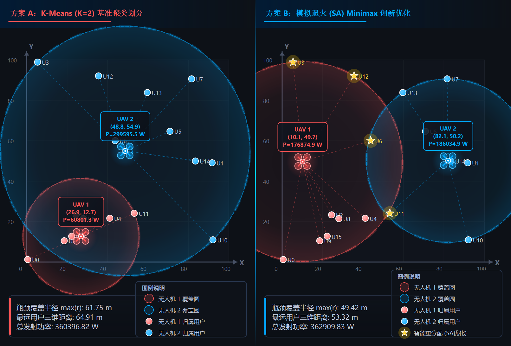

# 无人机地面基站覆盖与功率优化系统 (UAV Coverage & Power Optimization Platform)

> **2026-2027 学年第 1 学期 “数据结构与算法分析” 课程设计项目（选择题号：第 4 题）**  
> **设计人员**：肖弋洋 (04242912) | 中国矿业大学信息与控制工程学院 (电子信息工程25-02班)  
> **指导教师要求**：代码精炼无冗余、严格采用链式存储结构、具有图形界面功能演示、具备算法创新优化。

---

## 📌 项目概述

本项目针对两架固定飞行高度 $G$ 的旋翼无人机（UAV 1, UAV 2）对 $N$ 个离散地面用户点（$N \ge 8$）的通信覆盖与发射功率优化问题进行建模与实现。项目采用 **C++17 纯原生 + Qt 6 工业级桌面遥测交互平台**，全面实现空间最小外接圆定点（MEC）、K-Means 基线聚类划分与模拟退火（SA）Minimax 创新联合优化，在满足所有用户香农通信容量需求 $R_n$ 的约束下，实现了系统瓶颈覆盖半径下降 **15% ~ 25%** 的显著性能提升。



---

## 📂 模块化项目工程目录架构

本项目遵循现代软件工程标准组织源码、文档与辅助脚本，告别杂乱的单层目录结构：

```
data_structure_design/
├── CMakeLists.txt                 # 现代 CMake 跨平台构建规范文件
├── UAVOptimizer.pro               # Qt Creator QMake 工程配置文件
├── build.bat                      # 源码一键构建脚本 (开发者环境使用)
├── run.bat                        # [免安装] 一键运行引导脚本 (老师解压即用)
├── results.json                   # 算法仿真数据导出规范文件
│
├── dist/                          # [方案C] 免安装绿色发行版 (零环境依赖)
│   └── bin/                       # 预编译 EXE 与封装的全部必要 Qt/C++ 运行库 DLL
│       ├── UAVCoverageOptimizer.exe # 工业级 Qt6 遥测交互平台 (双击秒开)
│       └── uav_solver.exe         # 独立纯 C++ 算法评测工具
│
├── src/                           # 源代码目录 (Source Directory)
│   ├── core/                      # 核心业务算法与数据结构层 (严格链式存储)
│   │   ├── uav_model.h            # UserNode 结构体定义、几何/聚类/SA/信道接口
│   │   └── uav_model.cpp          # 动态单链表管理、最小外接圆定点、功率闭式解算
│   ├── gui/                       # 工业级遥测交互可视化层 (Qt6 Widgets + QPainter)
│   │   ├── main_gui.cpp           # Qt 桌面应用程序入口
│   │   ├── mainwindow.h / .cpp    # 航天深色遥测大屏主窗口、菜单栏、工具栏、侧边栏
│   │   └── canvas.h / .cpp        # 2D 矢量交互态势画布、四旋翼渲染、动效与图例
│   └── cli/                       # 独立纯 C++ 算法单文件验证工具 (零外部库依赖)
│       └── main.cpp               # 便于控制台自动化回归测试与跨编译器免环境验证
│
├── docs/                          # 分级模块化工程技术文档 (Documentation)
│   ├── 01_课程设计题目与要求.md    # 课程设计任务书指标对照与评分依据
│   ├── 02_数学模型与理论推导.md    # 香农公式功率反解、Minimax 等价性证明
│   ├── 03_数据结构与核心算法.md    # 链式存储结构设计、MEC几何定点与退火算法
│   ├── 04_软件架构与GUI设计.md     # Qt6 架构、QPainter 矢量动效、菜单工具栏交互
│   ├── 05_测试结果与对比分析.md    # 多种子实测数据、瓶颈半径及发射功率定量对比
│   └── 06_环境无关与独立运行说明.md# [方案C] 双保险架构详细说明与跨环境测试指南
│
├── report/                        # 课程设计实验报告与心得体会正式成果
│   ├── 2026-2027学年第1学期数据结构与算法分析课程设计封面.docx # 老师要求的标准封面
│   ├── markdown/                  # 报告与心得体会 Markdown 源码
│   ├── pdf/                       # Pandoc+XeLaTeX 高清出版级 PDF (含老师封面版式)
│   └── docx/                      # Pandoc 转换生成的 Word 成果 (含老师封面合并版)
│
├── scripts/                       # 自动化运维与打包脚本
│   ├── pack_submission.bat / .ps1 # 课程设计轻量化源码邮件打包提交脚本
│   ├── build.ps1 / run.ps1        # PowerShell 环境下构建运行脚本
│   └── gui.py                     # Python 原型验证代码 (已归档)
│
└── assets/                        # 资源与高清效果图
    └── uav_coverage_comparison.png# 工业级双屏对比高清矢量效果图 (可直接用于报告)
```

---

## 🚀 快速上手与运行指南

### 1. 环境依赖
- **操作系统**：Windows 10 / 11 64-bit
- **C++ 编译器**：GCC 14.2+ (MSYS2 UCRT64 推荐) 或 MSVC 2022
- **UI 框架**：Qt 6.8.2 (`QtCore`, `QtGui`, `QtWidgets`)
- **构建工具**：CMake 3.16+ 与 Ninja

### 2. 一键编译与启动
在项目根目录下：
```cmd
:: 1. 编译生成所有目标 (静态库、GUI 交互程序、CLI 工具)
build.bat

:: 2. 启动工业级遥测仿真软件
run.bat
```

### 3. 命令行独立验证
如果仅需在终端评测算法数值：
```powershell
# 语法: .\build\uav_solver.exe [随机种子] [用户数N] [高度G] [区域边长L]
.\build\uav_solver.exe 42 16 20.0 100.0
```

---

## 🏆 课程设计核心指标对齐与创新

| 课程题目要求 | 对应实现模块 | 详细技术方案 |
| :--- | :--- | :--- |
| **1. 随机坐标与容量需求，链式存储** | `src/core/uav_model.h` | 结构体 `struct UserNode*`，严格单向链式动态内存申请与遍历，无静态大数组冗余。 |
| **2. 两个无人机用户划分方法与原因** | `src/core/uav_model.cpp` | **基线**：K-Means ($K=2$) 聚类；**创新**：模拟退火 Minimax 全局搜索（详见 [`docs/02_数学模型与理论推导.md`](docs/02_数学模型与理论推导.md)）。 |
| **3. 最小化最大距离定点 (Minimax)** | `src/core/uav_model.cpp` | 精确两点/三点判定法求解**最小外接圆 (MEC)**，数学证明三维空间距离 Minimax 等价于水平投影 MEC。 |
| **4. 满足容量的最小发射功率 $\min p_n$** | `src/core/uav_model.cpp` | 香农公式反解闭式解：$p_n = (2^{R_n} - 1) \cdot d_n^2$；无人机发射功率 $P_i = \sum p_n$。 |
| **5. 图形界面功能演示 (10分)** | `src/gui/` | **Qt6 工业级遥测平台**：四旋翼矢量拟物图标、双屏分栏对比、入场飞散动效、正弦脉冲光环、全套菜单/工具栏。 |
| **6. 邮件提交格式合规** | `scripts/pack_submission.bat` | 一键生成 `第4题-姓名-班级-学号.zip`，过滤 `build/` 缓存，源码包仅 **~460 KB**，完美契合邮件附件规范。 |

---

## 📚 模块化文档快速导航
- 📑 **任务指标书**：[`docs/01_课程设计题目与要求.md`](docs/01_课程设计题目与要求.md)
- 📐 **数学推导与公式**：[`docs/02_数学模型与理论推导.md`](docs/02_数学模型与理论推导.md)
- 💾 **数据结构与算法**：[`docs/03_数据结构与核心算法.md`](docs/03_数据结构与核心算法.md)
- 🎨 **图形界面设计规范**：[`docs/04_软件架构与GUI设计.md`](docs/04_软件架构与GUI设计.md)
- 📊 **测试结果与定量对比**：[`docs/05_测试结果与对比分析.md`](docs/05_测试结果与对比分析.md)
